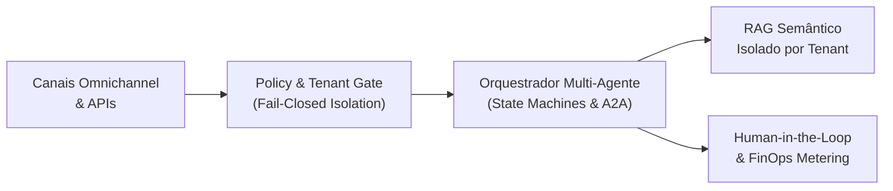

# 🤖 Case Study — Clube Siga Agent Platform (Multi-Tenant AI Control Plane)

> **Nota de Segurança & Propriedade Intelectual:** Este repositório apresenta apenas a visão conceitual de produto e padrões de engenharia de software. Detalhes de infraestrutura, topologia de rede e código-fonte permanecem privados.

---

## 🎯 Desafio de Engenharia

Construir uma plataforma **SaaS Multi-Tenant de Agentes de IA** onde múltiplas empresas possam operar seus próprios assistentes inteligentes, bases de conhecimento (RAG) e canais de atendimento omnichannel sem risco de vazamento de contexto entre clientes e com controle rigoroso de custos de IA (*FinOps*).

---

## 🏗️ Padrões de Arquitetura Aplicados

### Destaques Técnicos
- **Isolamento *Fail-Closed* por Tenant:** Nenhuma operação de memória, RAG, modelo ou integração externa é executada sem resolução prévia e validada do contexto do cliente e de suas permissões.
- **Defesa em Camadas para RAG:** Sanitização de entradas, avaliação automatizada de relevância/fidelidade de respostas e versionamento com *rollback* imediato de base de conhecimento.
- **Governança *Human-in-the-Loop* (HITL):** Operações sensíveis de engenharia, infraestrutura ou comunicação passam obrigatoriamente por filas de aprovação humana auditáveis antes da execução.
- **FinOps & Unit Economics:** Medição granular de consumo de tokens por tenant, agente e modelo para visibilidade em tempo real de margem operacional.
