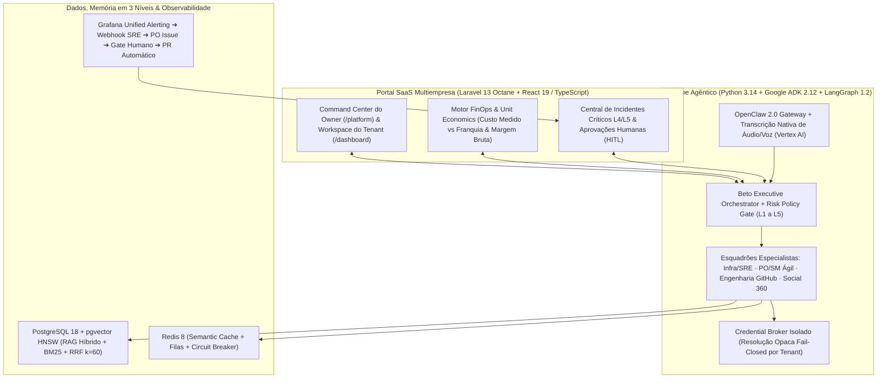

# 🤖 Case Study Arquitetural — Clube Siga Agent Platform (Multi-Tenant AI Control Plane)

> **Nota de Governança:** Este repositório público apresenta a arquitetura de engenharia da **Clube Siga Agent Platform**. O repositório principal permanece privado.

---

## 🎯 Visão Geral

A **Clube Siga Agent Platform** é uma plataforma **SaaS Multi-Tenant de Governança e Orquestração de Agentes de IA** projetada para operar dois planos de controle desacoplados sobre a mesma infraestrutura:

1. **Plano Executivo Corporativo (`Beto IA`):** Orquestrador executivo que governa múltiplos produtos, frotas de VPS/Clusters, custos (FinOps), incidentes críticos L4/L5, borda Cloudflare e um **Esquadrão Autônomo de Engenharia de Software**.
2. **Plano Multi-Tenant de Clientes (`Justino`, `Luís` e Agentes Dedicados):** Cada empresa cliente possui seu próprio orquestrador, RAG isolado (`pgvector`), canais sociais (`Meta Graph API`, `WhatsApp`, `Telegram`), políticas de modelos versionadas e limites de orçamento.

---

## 🏗️ Arquitetura de Referência (Control Plane, RAG & Self-Healing DevOps)

---

## 🛡️ Diferenciais de Engenharia Sênior

- **Isolamento Multi-Tenant *Fail-Closed*:** Nenhuma operação de memória, RAG, modelo ou canal social executa sem `tenant_id`, política versionada e credencial escopada válida no `credential-broker`.
- **Defesa em 5 Camadas contra *Indirect Prompt Injection*:** Sanitização de documentos, quarentena em Cloudflare R2, avaliação automatizada da **Tríade RAG** (*Context Relevance*, *Groundedness*, *Answer Relevance*) e rollback de conhecimento em 1 clique.
- **Pipeline Autônomo DevOps ➔ PO ➔ Gate Humano ➔ Developer PR:**
  1. O **Agente DevOps/SRE** inspeciona logs de produção e recebe webhooks do **Grafana Unified Alerting**;
  2. O **Agente Product Owner (PO)** valida o *Definition of Ready (DoR)*, sanitiza segredos e abre a tarefa no **GitHub Issues** (ou Portal/Notion);
  3. A **Central de Incidentes L4/L5** exige confirmação humana explícita do Owner;
  4. Após aprovado, o **Agente Desenvolvedor** cria uma branch isolada (`fix/beto-issue-N`), aplica o patch + teste automatizado via *GitHub Git Data API* (sem clone em disco e sem shell) e abre o Pull Request para `dev`.
- **Qualidade & Arquitetura Limpa:** Limite estrito de $\le 300$ linhas por módulo Python de produção, tipagem estrita (`mypy --strict`), `Ruff`, `pytest` (+560 testes) e `Pest PHP` + `PHPStan Level 7` (+135 testes).
